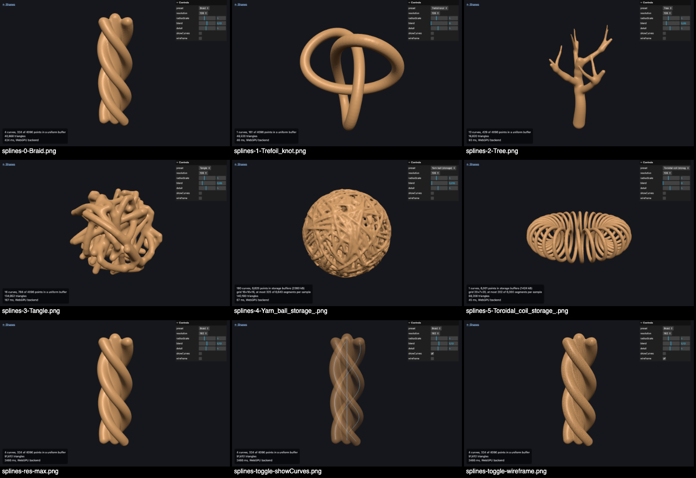

# three-sdf-geometry-generator

<p>
<center>

</center>
</p>

Generate a three.js `BufferGeometry` from a signed distance function (SDF), or from a level set of any scalar field such as a density, evaluated on the GPU with `WebGPURenderer` and TSL.

This is a port of the `SDFGeometryGenerator` addon from three.js [PR #26837](https://github.com/mrdoob/three.js/pull/26837), which was later removed from three.js and only ever worked with `WebGLRenderer`. The distance field is sampled by a TSL compute shader, read back from the GPU, and turned into a mesh with Surface Nets.

## Install

```sh
npm install three-sdf-geometry-generator three
```

`three` is a peer dependency (r175 or newer), so the package always uses your copy of three.js.

## Usage

```js
import { WebGPURenderer } from 'three/webgpu';
import { Fn, length, vec2 } from 'three/tsl';
import { SDFGeometryGenerator } from 'three-sdf-geometry-generator';

const renderer = new WebGPURenderer();
const generator = new SDFGeometryGenerator( renderer );

const torus = Fn( ( [ p ] ) => length( vec2( length( p.xz ).sub( 0.6 ), p.y ) ).sub( 0.2 ) );

const geometry = await generator.generate( 128, torus, 1 );
scene.add( new Mesh( geometry, material ) );
```

The renderer is initialized automatically if you haven't called `await renderer.init()` yet.

### Without a bundler

Map the bare specifiers with an import map. The package is plain ES modules with no build step, so any CDN that serves raw npm files works:

```html
<script type="importmap">
{
  "imports": {
    "three": "https://cdn.jsdelivr.net/npm/three@0.186.1/build/three.webgpu.js",
    "three/webgpu": "https://cdn.jsdelivr.net/npm/three@0.186.1/build/three.webgpu.js",
    "three/tsl": "https://cdn.jsdelivr.net/npm/three@0.186.1/build/three.tsl.js",
    "three-sdf-geometry-generator": "https://cdn.jsdelivr.net/npm/three-sdf-geometry-generator@1.0.0/src/SDFGeometryGenerator.js"
  }
}
</script>
<script type="module">
  import { SDFGeometryGenerator } from 'three-sdf-geometry-generator';
</script>
```

Avoid CDNs that rewrite imports (such as esm.sh) unless three.js comes from the same CDN, or you'll end up with two copies of three.js.

## API

### `new SDFGeometryGenerator( renderer )`

`renderer` must be a `WebGPURenderer` from `three/webgpu`. Both its WebGPU backend and its WebGL 2 fallback are supported for TSL distance functions.

### `generator.generate( res = 64, distFunc = sphere, bounds = 1, options = {} ) → Promise<BufferGeometry>`

Samples `distFunc` on a grid of `res × res × res` cells covering the cube `[-bounds, bounds]³` and returns the surface where it equals `options.level`: by default, the zero level of a signed distance function.

- `res` is the number of cells per axis, any integer ≥ 2.
- `distFunc` is a TSL function or a WGSL string (see below). The default is a sphere of radius 0.5.
- `bounds` is the half-extent of the sampled cube, centered at the origin.
- `options.level` is the field value on the surface. The default is `0`.
- `options.inside` says which side of the level is inside: `'below'` (the default) for signed distances, `'above'` for densities. See [Level sets and density fields](#level-sets-and-density-fields).

The result is an indexed geometry with `position` and `normal` attributes. Normals come from the SDF gradient, so there's no need to call `computeVertexNormals()`. Indices are 16-bit when possible and 32-bit otherwise.

`generateAsync()` is the same method under three.js's naming convention for async methods.

### `generator.maxSamplesPerPass`

The volume is evaluated in slabs of whole z-slices, so memory use stays bounded at any resolution. This property caps the samples per compute dispatch. The default is `4194304` (16 MB of floats), which is well under WebGPU's default storage-buffer limit. While the CPU meshes one slab, the GPU already evaluates the next.

## Distance functions

A distance function receives the sample position and returns the signed distance: negative inside, positive outside. It doesn't have to be an exact Euclidean distance, but the better it approximates one near the surface, the more accurately vertices are placed.

**TSL** works on every backend. Plain arrow functions and `Fn()` are both accepted:

```js
import { Fn, abs, length, max, min, vec3 } from 'three/tsl';

const sphere = ( p ) => length( p ).sub( 0.5 );

const roundedBox = Fn( ( [ p ] ) => {
  const q = abs( p ).sub( vec3( 0.5, 0.3, 0.4 ) );
  return length( max( q, 0.0 ) ).add( min( max( q.x, max( q.y, q.z ) ), 0.0 ) ).sub( 0.05 );
} );
```

**WGSL** works only on the WebGPU backend. The string must define `fn dist( p: vec3<f32> ) -> f32`, or `fn field( p: vec3<f32> ) -> f32` if the name `dist` doesn't fit (`dist` wins if both are defined). Helper functions can appear in any order:

```js
const geometry = await generator.generate( 128, /* wgsl */`
  fn dist( p: vec3<f32> ) -> f32 { return sphere( p, 0.5 ); }
  fn sphere( p: vec3<f32>, r: f32 ) -> f32 { return length( p ) - r; }
`, 1 );
```

## Level sets and density fields

The field doesn't have to be a distance. Any scalar field works, and the `level` and `inside` options pick which of its level sets becomes the surface. For a density, where the shape is the region of high values, pass `inside: 'above'`:

```js
import { dot, exp } from 'three/tsl';

const blob = ( p ) => exp( dot( p, p ).mul( - 5 ) ); // a Gaussian, 1 at the origin

const geometry = await generator.generate( 128, blob, 1, { level: 0.5, inside: 'above' } );
```

The generator samples `field − level`, or `level − field` when `inside` is `'above'`, and meshes where that crosses zero. Everything else works as it does for distance functions: normals come from the field's gradient and point outward, and regions cut off by `bounds` are capped. Calling `generate()` again with another `level` gives the next nested shell of the same field. Each call samples the field again.

Vertices are placed by linear interpolation between neighbouring samples. That's exact for a field that varies linearly across a cell, as a distance function does near its surface. Densities often don't: a narrow Gaussian changes steeply. If the surface looks bumpy or faceted, raise `res` until each feature spans several cells.

## Example: tubes around splines

`examples/splineDistance.js` turns one or more three.js curves (`CatmullRomCurve3`, `CubicBezierCurve3`, `CurvePath` and so on) into a distance function for tubes around them. It ships with the package and has its own type declarations:

```js
import { CatmullRomCurve3, Vector3 } from 'three/webgpu';
import { splineDistance } from 'three-sdf-geometry-generator/examples/splineDistance.js';

const curve = new CatmullRomCurve3( [ new Vector3( - 0.6, 0, 0 ), new Vector3( 0, 0.4, 0.2 ), new Vector3( 0.6, 0, 0 ) ] );

const tubes = splineDistance( [ curve, otherCurve ], {
  radius: ( u, curveIndex ) => 0.03 + 0.05 * Math.sin( Math.PI * u ), // or a number; u runs 0 → 1 along the curve
  segments: 64, // polyline segments per curve, or ( curve, curveIndex ) => count
  blend: 0.1    // smooth union between different curves; 0 = hard union
} );

const geometry = await generator.generate( 128, tubes, 1 );
```

Each curve is sampled into evenly spaced points (by arc length), which are uploaded as a uniform array. In the shader, the distance to a curve is the distance to its nearest segment minus the radius. Curves are combined with `min()`, or with a smooth minimum when `blend` is set, and any curve whose bounding box is too far away to matter is skipped. The result is a regular TSL function, so you can combine it with other shapes: `( p ) => min( tubes( p ), length( p ).sub( 0.3 ) )`.

Some limits to keep in mind:

- **Accuracy.** The tube follows the sampled polyline, not the exact curve. Each segment sags from the curve by roughly `L² × curvature / 8`, so choose enough segments to keep that below the cell size (`2 * bounds / res`). A varying radius is interpolated along each segment, which is close to, but not exactly, a true distance.
- **Point budget.** All curves together may use at most 4096 points (`segments + 1` per curve), the capacity of a 64 kB uniform buffer. For more, use the storage-buffer version described in the next section.
- **Cost.** Work grows with `res³ × total segments`. For very heavy fields, lower `generator.maxSamplesPerPass` so each GPU dispatch stays short; long dispatches can trip the operating system's GPU watchdog and lose the device.

`examples/splines.html` is an interactive demo with presets including a braid, a trefoil knot, a tree with tapered and blended branches, and a tangle of random splines. It has controls for radius, blend, detail (segments per curve) and resolution, and an overlay that shows the source curves through the mesh.

## Example: large curve sets with storage buffers

`examples/splineDistanceStorage.js` takes the same curves and options as `splineDistance()`, and is meant for curve sets beyond its 4096-point limit, such as thousands of curves or a single curve with tens of thousands of points:

```js
import { splineDistanceStorage } from 'three-sdf-geometry-generator/examples/splineDistanceStorage.js';

const tubes = splineDistanceStorage( curves, { radius: 0.02, blend: 0.015, margin: 0.06 } );
const geometry = await generator.generate( 128, tubes, 1 );

tubes.dispose( renderer ); // free the GPU buffers once you're done generating
```

Moving the points into a storage buffer only removes the size limit. What makes large sets fast is a spatial grid. On the CPU, every segment is listed in each grid cell it could affect, and in the shader each sample loops only over its own cell's list instead of over every curve. The lists stay in curve order, so blending between curves gives the same result as `splineDistance()`; where both can run, the meshes are identical. `tubes.info` reports the grid size, the uploaded bytes, and the most segments any sample has to test.

Beyond `margin`, the field is clamped. That doesn't change the surface as long as `margin` is at least 1.75 × the sample spacing (`2 * bounds / res`), because Surface Nets only reads exact values in cells that touch the surface. The default of 0.1 covers `res` ≥ 35 at `bounds` = 1. A larger margin is safe but makes the cell lists longer.

This example needs the WebGPU backend: the WebGL 2 fallback can't read storage buffers at arbitrary positions. Tubes thinner than about 1.5 cells come out less accurate, as with any Surface Nets mesh, so raise `res` for fine wire. The demo page has two large presets: a yarn ball (180 curves, about 8,800 points) and a toroidal coil (one curve, 6,000 segments).

## Example: point densities

`examples/pointDensity.js` turns a set of points into a density field: one Gaussian kernel per point, each peaking at 1, all summed. Where kernels overlap they fuse smoothly, so a few points give metaballs and a point cloud gives a kernel density estimate:

```js
import { Vector3 } from 'three/webgpu';
import { pointDensity } from 'three-sdf-geometry-generator/examples/pointDensity.js';

const points = [ new Vector3( - 0.3, 0, 0 ), new Vector3( 0.25, 0.1, 0 ), new Vector3( 0, - 0.3, 0.1 ) ];

const density = pointDensity( points, {
  radius: 0.15 // the kernel's standard deviation, or ( point, index ) => radius
} );

const geometry = await generator.generate( 128, density, 1, { level: 0.5, inside: 'above' } );
```

An isolated point gives a sphere of radius `radius × √(−2 ln level)`, about 1.18 × `radius` at level 0.5. The points are uploaded as a uniform array, so at most 4096 fit. Every sample sums all the kernels, so the cost grows with `res³ × points`.

`examples/density.html` is an interactive demo with a level slider and three presets: metaballs, a spiral galaxy made of 960 points, and the probability density of a hydrogen 3d orbital. At low levels the orbital is two lobes and a torus; above 0.25 the torus disappears.

## Migrating from the WebGL addon

The API is the same, with two changes. `generate()` returns a Promise, because GPU readback is asynchronous in WebGPU. And GLSL distance functions must be ported to TSL or WGSL; passing a GLSL string throws an error that says so.

```js
// before (WebGLRenderer)
const geometry = generator.generate( 64, 'float dist( vec3 p ){ return length(p) - 0.5; }', 1 );

// after (WebGPURenderer)
const geometry = await generator.generate( 64, ( p ) => length( p ).sub( 0.5 ), 1 );
```

There are also some behavioural differences, all improvements:

- **Real distances.** Actual distances are sampled, not just inside/outside, so vertices are interpolated onto the surface rather than hugging the voxel grid.
- **Any resolution.** `res` no longer has to be a power of two, and there is no texture-size ceiling.
- **Closed meshes.** Shapes clipped by `bounds` are capped, so meshes are always closed.
- **Normals included.**

## Mesh quality

The output is always closed (no holes) with outward-facing triangles. Like any Surface Nets mesher, which places one vertex per cell, it can produce non-manifold edges where a feature is thinner than a cell or where a saddle point falls on a cell face. Raising `res` removes them. This doesn't affect rendering, but it can matter for tools that require strictly 2-manifold input, such as some CSG libraries or slicers.

As a rough guide, a 128³ torus (55k triangles) takes about 0.2 s and a 256³ one about 1 s on a software GPU. Real GPUs are faster.

## Compatibility

- **three.js r175 or newer.** Tested with r175, r180 and r186. r171 does not work.
- **TypeScript.** Declarations are included and need `@types/three` 0.183 or newer.
- **WebGL 2 fallback.** TSL functions are designed to run on it, but only the WebGPU backend is covered by the automated tests.

## Development

```sh
npm install
npm test            # headless WebGPU tests in Node (Dawn via the `webgpu` package)
npm run test:types  # type-checks a consumer against the declarations
npm run example     # serves the package; open http://localhost:8080/examples/ (shapes), /examples/splines.html or /examples/density.html
```

The tests run on a real WebGPU device. On machines without a GPU, install a software Vulkan driver, for example `apt install mesa-vulkan-drivers` on Debian or Ubuntu.

## Credits and license

MIT. The original WebGL addon is by santiago ([@glitch_life](https://github.com/santi-grau)) and the three.js authors. The Surface Nets formulation follows S. F. Gibson, "Constrained Elastic Surface Nets" (1998), with edge tables after Mikola Lysenko's [isosurface](https://github.com/mikolalysenko/isosurface) package (MIT).
